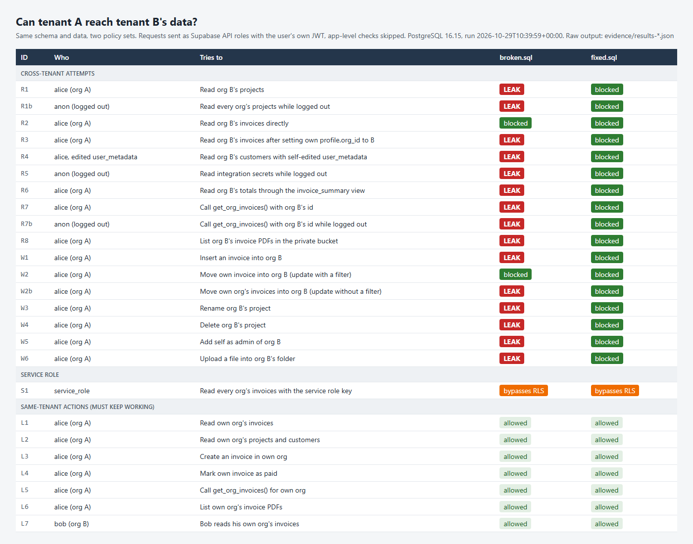
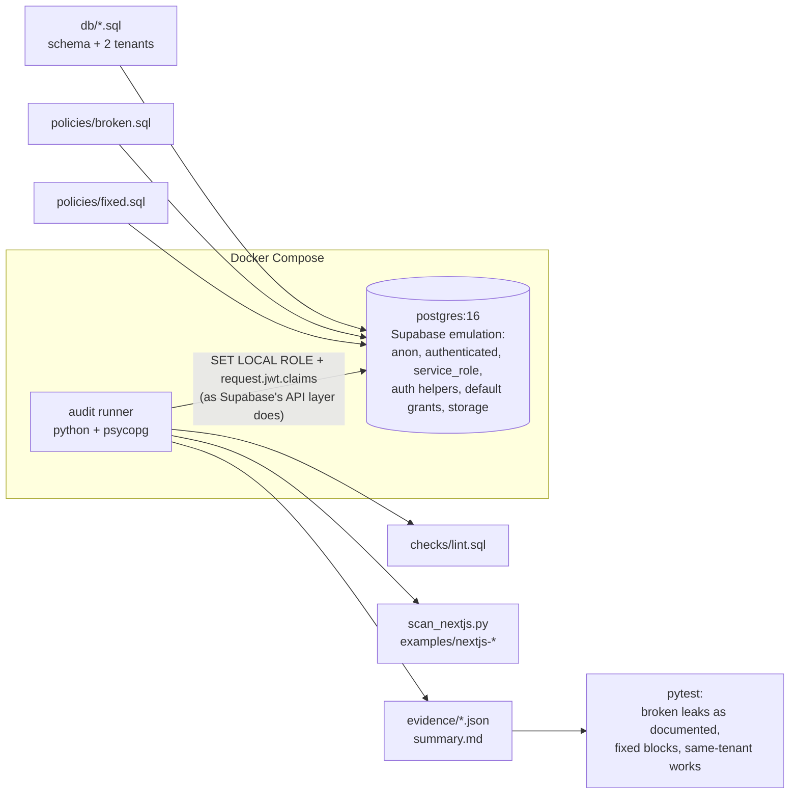
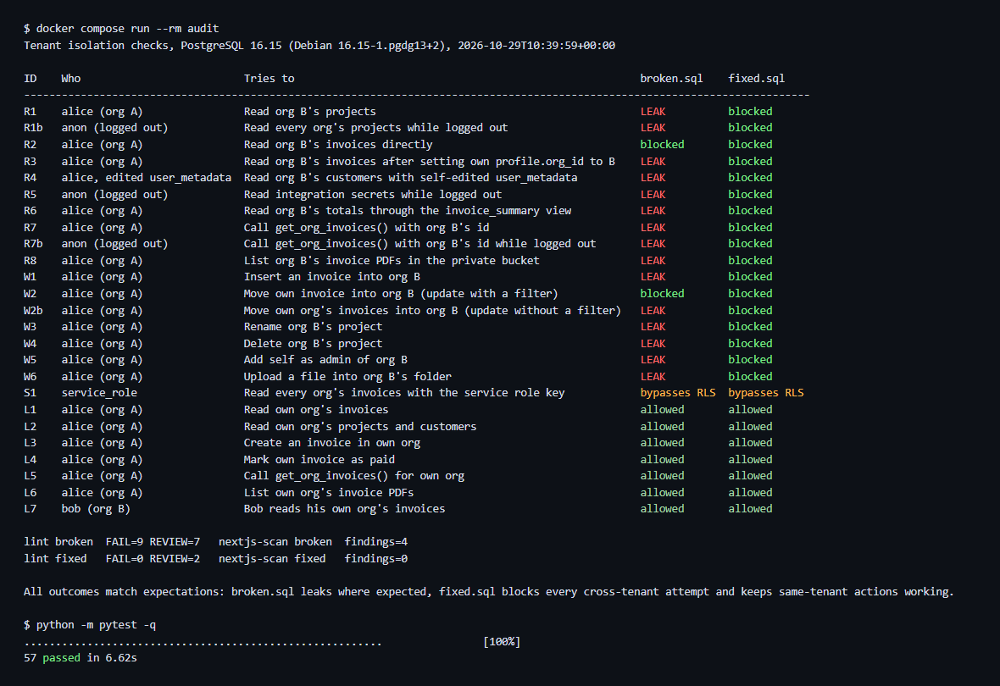

# supabase-rls-tenant-audit

Can tenant A read tenant B's data in your AI-built Supabase app?

*"Our multi-tenant SaaS was written mostly by AI coding agents and never had a senior human
review. Can one customer see another customer's data?"*

This repo shows the method I use to answer that, run on a small fictional invoicing schema. It is
an open-source demo: plain Postgres in Docker, set up to behave like Supabase, with two policy
sets (one with mistakes that AI-generated code often makes, one fixed) and an attack harness that
tries every cross-tenant path as a real user would. Every result below comes from a script in
this repo and the raw output is in [`evidence/`](./evidence/).

- **Attack tests, not opinions.** As user A (and as a logged-out visitor), try to read, insert,
  update and delete tenant B's rows, call RPCs, read views and list storage files, with only
  the rights the public anon key and the user's own JWT give (set at the database level, the
  way Supabase's API does; see Limits). App-level checks are skipped on purpose.
- **Broken vs. fixed, same data.** `policies/broken.sql` and `policies/fixed.sql`. The tests
  assert that the broken set leaks where documented and the fixed set blocks every attempt
  while same-tenant actions keep working.
- **Static sweep** of the database catalog ([`checks/lint.sql`](./checks/lint.sql)): tables
  without RLS, `USING (true)`, login-only policies, `user_metadata`, SECURITY DEFINER functions
  and views, functions callable by `anon`.
- **Service-key scan** of Next.js code ([`audit/scan_nextjs.py`](./audit/scan_nextjs.py)):
  service key in `NEXT_PUBLIC_`, in client components, in route handlers that never identify
  the caller.
- **A sample risk-ranked review report** ([`report/sample-review-report.md`](./report/sample-review-report.md),
  [PDF](./report/sample-review-report.pdf)) and a
  [first-pass checklist](./docs/ai-built-supabase-review-checklist.md).



## Results

| ID | Who | Tries to | `broken.sql` | `fixed.sql` |
|---|---|---|---|---|
| R1 | alice (org A) | Read org B's projects | **LEAK** | blocked |
| R1b | anon (logged out) | Read every org's projects while logged out | **LEAK** | blocked |
| R2 | alice (org A) | Read org B's invoices directly | blocked | blocked |
| R3 | alice (org A) | Read org B's invoices after setting own `profile.org_id` to B | **LEAK** | blocked |
| R4 | alice, edited user_metadata | Read org B's customers with self-edited `user_metadata` | **LEAK** | blocked |
| R5 | anon (logged out) | Read integration secrets while logged out | **LEAK** | blocked |
| R6 | alice (org A) | Read org B's totals through the `invoice_summary` view | **LEAK** | blocked |
| R7 | alice (org A) | Call `get_org_invoices()` with org B's id | **LEAK** | blocked |
| R7b | anon (logged out) | Call `get_org_invoices()` with org B's id while logged out | **LEAK** | blocked |
| R8 | alice (org A) | List org B's invoice PDFs in the private bucket | **LEAK** | blocked |
| W1 | alice (org A) | Insert an invoice into org B | **LEAK** | blocked |
| W2 | alice (org A) | Move own invoice into org B (update with a filter) | blocked | blocked |
| W2b | alice (org A) | Move own org's invoices into org B (update without a filter) | **LEAK** | blocked |
| W3 | alice (org A) | Rename org B's project | **LEAK** | blocked |
| W4 | alice (org A) | Delete org B's project | **LEAK** | blocked |
| W5 | alice (org A) | Add self as admin of org B | **LEAK** | blocked |
| W6 | alice (org A) | Upload a file into org B's folder | **LEAK** | blocked |
| S1 | service_role | Read every org's invoices with the service role key | bypasses RLS | bypasses RLS |
| L1–L7 | alice / bob | Same-tenant reads, inserts, updates, RPC and storage | allowed | allowed |

Raw results, including the JWT claims, the SQL and the rows returned or the error for every
check: [`results-broken.json`](./evidence/results-broken.json),
[`results-fixed.json`](./evidence/results-fixed.json).

**What the table shows:**

1. **A naive isolation test passes on the broken set.** R2, "can A read B's invoices?", is
   blocked. The leak only appears in R3, when A first changes a column of their own profile
   that the invoice policy trusts as the tenant. No static check flags that policy, because it
   does mention `org_id`; it just reads it from the wrong place
   ([`tests/test_lint.py`](./tests/test_lint.py) asserts exactly that).
2. **"RLS is enabled" is not the same as "tenants are isolated".** Views, SECURITY DEFINER
   functions, a table added by a later migration and the service role key all skip RLS.
3. **A pattern is not a path.** W2 is blocked even though the policy has `WITH CHECK (true)`:
   when an UPDATE reads columns, Postgres also checks the new row against the SELECT policy.
   W2b shows the same policy leaking when the update has no filter. In the sample report this
   is ranked Low, not Critical: rank by what an attacker can actually reach.
4. **The fix keeps the product working.** L1–L7 (same-tenant actions) are allowed in both sets.

## How it works



For each policy set the runner creates a fresh database (`rls_broken`, `rls_fixed`) with the
same schema and seed data. Each check opens a transaction, sets the API role and the JWT
claims, runs the attacker's SQL, verifies the effect as `postgres` inside the same
transaction when it is a write, and rolls back. Nothing persists between checks.

## Quick start

Requirements: Docker with Compose.

```bash
docker compose up -d              # Postgres 16 (official image), port 54329 on localhost
docker compose run --rm audit     # runs the attack matrix, writes evidence/, then pytest
```

Expected end of output:

```text
All outcomes match expectations: broken.sql leaks where expected, fixed.sql blocks every cross-tenant attempt and keeps same-tenant actions working.
...
57 passed
```



To run against your own Postgres instead of the container:
`pip install -r requirements.txt` then `DATABASE_URL=postgresql://... python -m audit.run && pytest`.
It needs a superuser (it creates the Supabase roles) and creates and drops the databases
`rls_broken` and `rls_fixed` on that server.

## How it fails safely

- **Never points at production.** It builds its own throwaway databases from the SQL files in
  this repo. To test a real app, point it at a local `supabase start` stack or a copy, never at
  the live project.
- **Every attack is rolled back.** Each check runs in its own transaction that always ends in
  ROLLBACK, so a successful "delete org B's project" leaves no trace and the next check starts
  from the same data.
- **Read-only checks are read-only.** `checks/lint.sql` only queries the catalog;
  `scan_nextjs.py` only reads files.
- **Unexpected results fail loudly.** `audit.run` exits non-zero if any outcome differs from
  the documented one, and pytest fails. A fix that over-blocks (denies a same-tenant action)
  fails as well, not only one that leaks.
- **Heuristics say REVIEW, not PASS.** When the lint or the scan cannot tell, it reports REVIEW
  for a human to close. A clean scan is never presented as proof.

## Design decisions and trade-offs

- **Plain Postgres instead of the Supabase CLI stack.** One official image, starts in seconds,
  no extra services. Trade-off: the HTTP layer (PostgREST), Supabase Auth and the Storage API
  are not in the loop. The harness reproduces what PostgREST does at the database level
  (`SET LOCAL ROLE` + `request.jwt.claims`), which is where RLS is enforced.
- **Python + psycopg instead of pgTAP.** pgTAP is not in the official Postgres image. Python
  also makes it easy to save the raw rows and errors as JSON evidence.
- **Tenant from a membership table, through helpers in a private schema.** `private.is_member()`
  is SECURITY DEFINER on purpose (it avoids recursive policies on `memberships`), lives in a
  schema the API does not expose, pins `search_path`, and only answers about `auth.uid()`.
- **`(select auth.uid())` in fixed policies.** Supabase's recommended form, so Postgres can
  evaluate it once per query instead of once per row. Not benchmarked here.
- **Fixed ids in the seed data.** Tests refer to tenants and rows directly; easier to read in
  the evidence files.

## Limits

- Tested on PostgreSQL 16 (the version is recorded in every evidence file), not against a
  hosted Supabase project. The Supabase parts are emulated: roles, `auth.uid()`/`auth.jwt()`,
  Supabase's default grants on `public`, and a minimal `storage` schema.
- R4 simulates the token a user gets after editing their own `user_metadata`; the
  `auth.updateUser()` call itself is not run (no Supabase Auth server here).
- Not tested: public buckets served by URL, signed URLs, Realtime, GraphQL, Edge Functions,
  rate limits.
- `examples/nextjs-*` are excerpts written for the scanner, not a runnable app. The scanner is a
  grep with import resolution, not a parser, and it does not inspect a production build.
- The lint is a set of heuristics with known blind spots (see R3). It complements the attack
  tests; it does not replace them.
- The schema is small and fictional. A real review starts by mapping the app's own tenant
  boundary, which takes longer than running these tests.

## Adapting this to your stack

1. Dump your schema and policies (`supabase db dump --schema public` or `pg_dump --schema-only`)
   and load them in place of `db/01-schema.sql` + `policies/*.sql`; keep
   `db/00-supabase-emulation.sql` or use a local `supabase start` database.
2. Seed two tenants with one user each in `db/02-seed.sql`.
3. Edit `audit/checks.py`: one entry per table/RPC/view/bucket that holds tenant data, as
   tenant A against tenant B, plus the same-tenant actions that must keep working.
4. Point `scan_nextjs.py` at your Next.js repo: `python -m audit.scan_nextjs ../your-app`.
5. Run it in CI on every migration, so the next AI-generated migration that reopens a hole
   fails the build.

## Repo map

| Path | What |
|---|---|
| `db/` | Supabase emulation, schema, seed (two tenants) |
| `policies/broken.sql` | RLS with common AI-generated mistakes, each commented with the test that exposes it |
| `policies/fixed.sql` | Corrected policies, view, RPC, grants and storage rules |
| `checks/lint.sql` | Static catalog checks (FAIL / REVIEW) |
| `audit/` | Harness: database builder, attack matrix, Next.js scanner, runner |
| `tests/` | pytest suite (attack outcomes, lint, scanner) |
| `evidence/` | Raw results of the last run |
| `report/` | Sample risk-ranked review report (fictional company), Markdown and PDF |
| `docs/` | Review checklist and screenshots |
| `examples/` | Next.js excerpts, broken and fixed |

MIT license.
